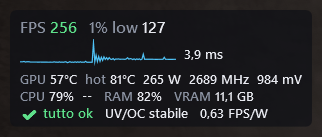
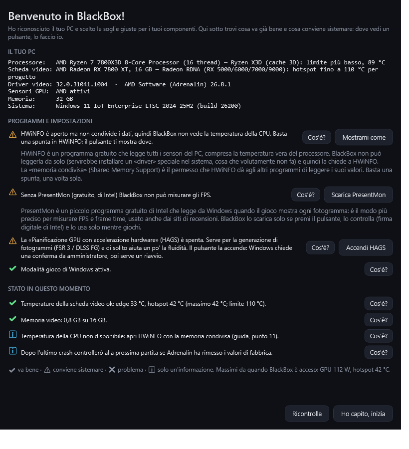
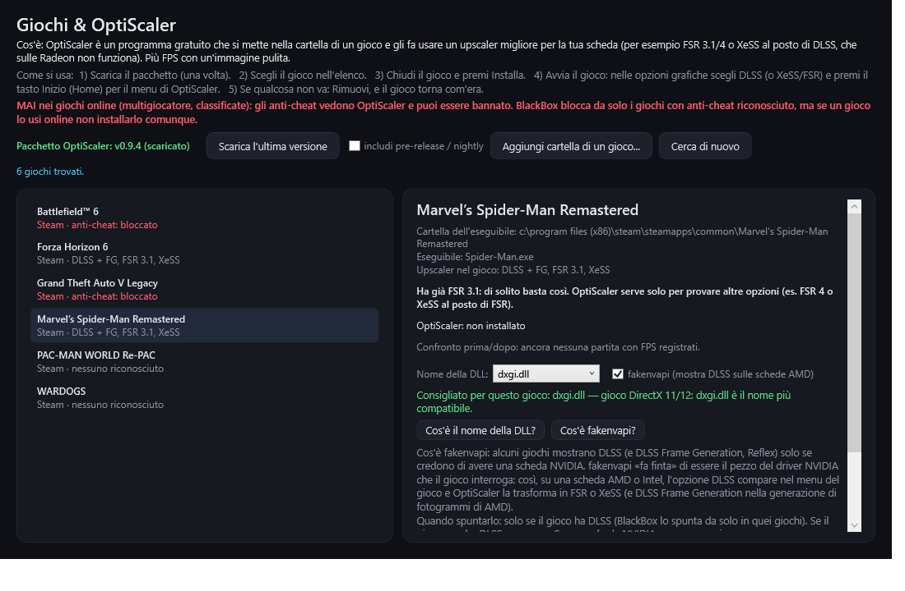

# BlackBox — la scatola nera del tuo PC, fatta per giocare

**BlackBox** registra di continuo lo stato del PC, come la scatola nera di un aereo, e
mentre giochi diventa il tuo cruscotto: FPS veri, overlay leggero, controllo della
stabilità di undervolt/overclock e gestione di OptiScaler. Se il PC si spegne da solo
ti dice cosa stava succedendo un attimo prima. Tutto **spiegato in parole semplici**:
ogni voce ha il suo pulsante «Cos'è?» e, quando c'è un problema, un pulsante che lo
sistema.

<p align="center">
  
</p>

> 🇬🇧 *BlackBox is a lightweight Windows "flight recorder" and gaming companion. It logs
> CPU/GPU/RAM every second straight to disk and explains unexpected shutdowns
> (Kernel-Power 41) with an automatic diagnosis. While you play it detects the game
> session by itself and gives you: FPS / 1% low / frame time via Intel PresentMon,
> frame-generation detection (real vs generated frames), a click-through in-game overlay
> (no injection, anti-cheat safe, ~0.2% CPU), a health check based on the **official
> temperature limits** of your exact CPU and GPU model (no false alarms), the likely cause
> and fix when the 1% low drops, undervolt/overclock stability and efficiency (real FPS
> per watt), "Adrenalin reset my tuning after a crash" alerts, per-game session reports,
> one-click fixes (HAGS, Game Mode, HWiNFO shared memory, automatic HWiNFO restart for the
> free 12-hour limit) and a fool-proof OptiScaler manager (anti-cheat, online and 32-bit
> games blocked, backups, recommended DLL name per game). No admin rights, no telemetry;
> the only network access is the downloads you start yourself. UI in Italian.*

---

## Cosa fa

### Sempre, in background

- **Registrazione ogni secondo, direttamente su disco** (scrittura senza cache): anche
  se la corrente salta di colpo resta l'ultimo secondo prima dello spegnimento.
- **CPU, GPU, RAM, VRAM**: carico, frequenze, tensione, potenza (picchi letti 5 volte
  al secondo), temperature edge/hotspot/memoria, ventola. Schede **AMD** (driver
  `atiadlxx.dll`) e **NVIDIA** (`nvml.dll`).
- **Temperatura vera della CPU** (Tctl/Tdie) da HWiNFO o LibreHardwareMonitor. Il limite
  delle **12 ore di HWiNFO gratuito** viene riconosciuto e, se vuoi, BlackBox **riavvia
  HWiNFO da solo** (mai durante una partita).
- **Eventi di Windows**: sospensione, crash del driver video (TDR), errori hardware
  WHEA, schermate blu, crash delle app.
- **Report automatico dopo uno spegnimento anomalo**, con diagnosi: picco di potenza
  GPU → alimentatore, crash a basso carico → undervolt CPU/RAM, surriscaldamento,
  sospensione/spegnimento, BSOD, spegnimento manuale.
- **Test A/B** delle configurazioni (BIOS, undervolt...): ogni crash è legato alla
  configurazione attiva.
- **Riconoscimento del PC**: al primo avvio una finestra di benvenuto mostra cosa ha
  riconosciuto (CPU, scheda video, driver, Adrenalin, Windows) e cosa conviene
  sistemare. Usa i **limiti di temperatura ufficiali di quel modello**, da una tabella
  costruita sulle schede tecniche di AMD, Intel e NVIDIA
  ([data/limiti.json](data/limiti.json), con la fonte per ogni riga): es. Ryzen 7
  7800X3D 89 °C, RX 7800 XT hotspot 110 °C, RTX 5070 85 °C. I modelli non in tabella usano
  una stima prudente dichiarata. Pulsante **Aggiorna i limiti** per scaricare la tabella
  più recente (solo su richiesta). Si accorge se cambi scheda o aggiorni il driver.
- **Sblocco prudente dei componenti di Windows bloccati** (TextInputHost, SearchHost,
  menu Start, Widget...): solo con consumo piatto da oltre 60 s, mai se li stai usando,
  **mai durante una partita**, al massimo 3 volte all'ora. Gli altri programmi non
  vengono mai chiusi.

### Quando giochi (parte da solo)

- **Sessione di gioco**: si apre quando il gioco in primo piano usa la GPU oltre il 60%
  per 20 s; a fine partita scrive un **report** (`sessione_<gioco>_<data>.txt`).
- **FPS, 1% low e frame time** con PresentMon di Intel. I momenti con il gioco in secondo
  piano (Alt+Tab) non contano.
- **Se il gioco scatta, dice perché e cosa fare**: inizio partita (shader), VRAM piena,
  calore, RAM piena, programma in background, processore al limite, generazione di
  fotogrammi con pochi FPS veri, scheda video al massimo.
- **Generazione di fotogrammi riconosciuta** (FSR 3, DLSS/XeSS FG): mostra anche gli
  **FPS reali**, cioè quelli calcolati davvero.
- **Overlay in gioco**: blocco o barra, 6 posizioni, colori, sfondo e righe a scelta,
  tasto rapido Ctrl+Shift+O. Non entra dentro il gioco (nessuna DLL iniettata), quindi
  niente conflitti con gli anti-cheat; il gioco resta in *Independent Flip*.
- **Undervolt / overclock**: stabilità (crash del driver, crash del gioco, throttling
  da calore), **efficienza in FPS reali per watt** confrontata con le tue partite
  precedenti, e avviso se **Adrenalin ha rimesso i valori di fabbrica** dopo un crash.
- **Leggero**: in partita passa a priorità bassa, dirada i controlli, non mostra
  notifiche (le tiene per fine partita). Misurato: circa **0,15–0,3% della CPU** con
  l'overlay acceso.

### Controllo dello stato: tutto spiegato, problemi sistemati

<p align="center">
  
</p>

- «✔ tutto ok» oppure cosa non va, con i limiti del tuo hardware e medie di 30 s (niente
  falsi allarmi per un picco di un attimo).
- Pulsante **«Cos'è?»** su ogni voce: HAGS, Modalità gioco, HWiNFO, PresentMon, edge e
  hotspot, undervolt, FPS per watt, 1% low, generazione di fotogrammi, VRAM, RAM...
- **Pulsanti che sistemano**: *Accendi HAGS*, *Accendi* la Modalità gioco, *Mostrami
  come* per HWiNFO, *Attiva* il riavvio automatico di HWiNFO, *Scarica PresentMon*.
  Le impostazioni di sicurezza di Windows non vengono mai toccate.

### Giochi & OptiScaler (a prova di errore)

<p align="center">
  
</p>

- Trova i giochi di **Steam, Epic, GOG**, quelli visti in sessione e le cartelle
  aggiunte a mano; riconosce gli upscaler (DLSS, FSR 3.1, FSR 2, XeSS) e consiglia se
  OptiScaler serve.
- **Blocca da solo i giochi con anti-cheat** (Easy Anti-Cheat, BattlEye, EA AntiCheat,
  Vanguard, ACE...), i **giochi online noti** anche senza file di anti-cheat (es. VAC di
  Steam) e i giochi **a 32 bit**: nessun pulsante, rischio ban azzerato. Prima di ogni
  installazione chiede conferma che il gioco si usi offline e avvisa se c'è già un'altra
  mod (es. ReShade).
- **Consiglia il nome della DLL giusto per ogni gioco** (dxgi.dll, winmm.dll per
  Vulkan/Microsoft Store/ReShade, il successivo dopo un problema) e spiega a cosa serve
  **fakenvapi**.
- **Installa, aggiorna, rimuove** OptiScaler: copie di sicurezza dei file del gioco,
  manifest, la rimozione riporta la cartella esattamente com'era; l'aggiornamento
  tiene le tue impostazioni. Dopo l'installazione spiega **come attivarlo nel gioco**.
- Controlla in partita che OptiScaler sia **davvero caricato** e riconosce i crash
  causati da una sua DLL.

## Privacy

- **Nessuna telemetria, nessun invio di dati, nessun aggiornamento automatico.**
- Le **uniche connessioni a internet** sono i download che avvii tu con un pulsante,
  da GitHub: **PresentMon** (verificato con la firma digitale di Intel), **OptiScaler**
  (verificato con l'impronta SHA-256 pubblicata da GitHub) e la **tabella dei limiti di
  temperatura** (dal repository di BlackBox).
- Legge i contatori di Windows, il driver della scheda video, il Registro eventi e, se
  aperti, i valori pubblicati da HWiNFO o LibreHardwareMonitor.
- Tutti i dati restano in `Documenti\BlackBox`. I CSV più vecchi di 14 giorni vengono
  cancellati da soli.

## Requisiti

- Windows 10 o 11, 64 bit, con .NET Framework 4.x (già incluso in Windows).
- **Non servono privilegi di amministratore.** Solo tre cose *facoltative* chiedono la
  conferma di Windows, **una volta**, e solo se premi tu il pulsante:
  - il permesso per gli FPS (gruppo *Performance Log Users*; su molti PC c'è già);
  - accendere HAGS;
  - il riavvio automatico di HWiNFO (un'operazione pianificata che sa fare solo questo).
- Facoltativi: **HWiNFO** con la memoria condivisa (temperatura della CPU) o
  **LibreHardwareMonitor**; **7-Zip** non serve (Windows apre da solo gli archivi di
  OptiScaler).

## Installazione

Scarica dalla pagina **[Releases](../../releases)**:

- **`BlackBox-Setup-1.2.5.exe`** (consigliato): installa BlackBox per il tuo utente
  in `%LocalAppData%\Programs\BlackBox`, **senza amministratore**, con collegamento nel
  menu Start, avvio automatico e disinstallazione da *Impostazioni → App*. Se BlackBox
  è già installato, prima lo disinstalla del tutto e poi installa la versione nuova; i tuoi
  dati restano.
- oppure **`BlackBox.exe`** da solo (versione portatile): mettilo in una cartella fissa e
  attiva *Avvio automatico* dalla finestra.

> Windows SmartScreen può mostrare un avviso perché i file non sono firmati
> digitalmente: **Ulteriori informazioni → Esegui comunque**, oppure compila tu dal
> sorgente.

Le novità di ogni versione sono in [CHANGELOG.md](CHANGELOG.md).

## Compilare dal sorgente

Nessuna dipendenza da scaricare: usa il compilatore C# incluso in Windows.

```powershell
powershell -ExecutionPolicy Bypass -File .\build.ps1
```

Crea `dist\BlackBox.exe` e l'installer `dist\BlackBox-Setup-<versione>.exe`.

**Aggiornare i limiti di temperatura:** aggiungi o correggi una riga in
[data/limiti.json](data/limiti.json) (con la fonte ufficiale), cambia la data in
`"versione"` e pubblica su `main`: gli utenti la ricevono con *Aggiorna i limiti*, senza
aspettare una nuova versione del programma.

### Parlarne con Claude (claude.ai)

`powershell -ExecutionPolicy Bypass -File .\per-claude-ai.ps1` prepara la cartella
`per-claude-ai\` (solo sul PC) con codice, guida e scheda del progetto. Le istruzioni per
creare il progetto su claude.ai sono in
[docs/per-claude-ai/00-LEGGIMI-PROGETTO.md](docs/per-claude-ai/00-LEGGIMI-PROGETTO.md).

## Uso

La guida completa, passo passo, è in **[GUIDA.md](GUIDA.md)** e si apre anche dal
programma (pulsante **Guida**). Il punto 17 spiega tutte le parole difficili.

| Azione | Effetto |
|---|---|
| Chiudi la finestra | va nell'area di notifica e **continua a registrare** |
| Clic sull'icona | riapre la finestra |
| Clic sulla riga *Controllo stato* | stato, «Cos'è?» e pulsanti che sistemano |
| Tasto destro sull'icona | report, sessioni, Giochi & OptiScaler, overlay, **Il tuo PC**, guida, esci |
| **Ctrl + Shift + O** | overlay acceso/spento, anche in gioco |

Opzioni da riga di comando: `--tray` (parte nell'area di notifica), `--logdir <cartella>`
(cartella dati diversa), `--exit` (chiude BlackBox già aperto).
Installer: `BlackBox-Setup-<versione>.exe /silent [/noauto]`; disinstallazione senza
finestre: `Disinstalla.exe /uninstall /quiet`.

### File generati (in `Documenti\BlackBox`)

| File | Contenuto |
|---|---|
| `monitor_AAAA-MM-GG.csv` | un campione al secondo (separatore `;`; colonne nuove sempre in coda) |
| `eventi.log` | eventi rilevati |
| `crash_AAAAMMGG_HHMMSS.txt` | report di ogni spegnimento anomalo |
| `sessione_<gioco>_<data>.txt` | report di ogni partita |
| `sessioni.csv` | una riga per partita (FPS, FPS reali, FPS/W, temperature, crash...) |
| `configurazioni.log` | configurazioni del test A/B |
| `impostazioni.ini` | impostazioni (overlay, valori imparati, hardware visto) |
| `limiti.json` | tabella dei limiti scaricata con *Aggiorna i limiti* (se più nuova di quella interna) |
| `tools\` | PresentMon, se scaricato |
| `optiscaler\` | pacchetti OptiScaler scaricati |

## Limiti

- L'overlay non appare nei giochi in **schermo intero esclusivo**: usa *finestra senza
  bordi*.
- La **temperatura della CPU** richiede HWiNFO (memoria condivisa) o
  LibreHardwareMonitor aperti.
- L'**AFMF** del driver AMD non è visibile ai programmi esterni: lì gli FPS sono quelli
  del gioco.
- OptiScaler **non si installa** nei giochi con anti-cheat, nei giochi online noti, nei
  giochi a 32 bit e nelle cartelle protette (Programmi) se servirebbe l'amministratore.
- La diagnosi è un'indicazione basata su regole, non una certezza.

## Programmi di terze parti

BlackBox **non include** questi programmi: li scarica, solo su tua richiesta, dalle
loro release ufficiali.

| Programma | Autore | Licenza | Pagina |
|---|---|---|---|
| PresentMon | Intel (GameTechDev) | MIT | https://github.com/GameTechDev/PresentMon |
| OptiScaler | progetto OptiScaler | GPL-3.0 | https://github.com/optiscaler/OptiScaler |

HWiNFO e LibreHardwareMonitor, se li usi, si installano a parte.

## Licenza

[MIT](LICENSE)
